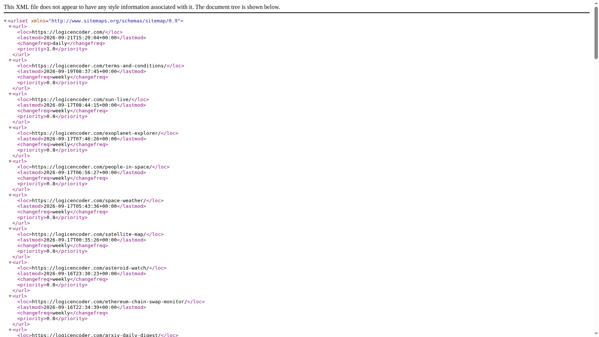

# Logic Encoder Sitemap Manager

A growing WordPress site needs a clear way to decide which pages belong in its XML sitemap and to check that the file really says what the owner intended. Logic Encoder Sitemap Manager is a WordPress administration area for exactly that: choose the content types, taxonomies and authors that are included, keep individual posts out through a blacklist, regenerate the file on a schedule or on demand, and test the result without leaving the dashboard. It is built for site owners and editors who want the sitemap under their own control instead of leaving it to defaults.

## Tech stack

| Layer | Technologies |
|---|---|
| Plugin | PHP, WordPress administration pages, WP-Cron for scheduled regeneration |
| Interface | JavaScript with WordPress AJAX actions for generate, search, test, bulk edit and import or export |
| Output | Static XML sitemap in the standard urlset format with location, last modification, change frequency and priority |

## Dashboard

The Dashboard is the starting screen. Quick actions generate the sitemap immediately, and a cron status block shows whether automatic generation is on, the schedule and the time of the next run. A sitemap information block shows the sitemap address, the size of the generated file and when it was last modified, so the first glance answers whether the file is current.

## Manage Content

Manage Content decides what the sitemap contains. Switches cover each public post type, each taxonomy (categories, tags and any custom ones) and the author archives. Turning a group off removes all its URLs at the next generation, which suits a site that, for example, wants posts and pages listed but not tag archives.

## URL List

The URL List shows every URL the sitemap will contain. A type filter narrows it to the homepage, posts, pages, categories, tags or authors, and each row shows the URL, its type, its priority and the actions available for it. Use it to answer "is this page in the sitemap" and to find entries that should not be there.

## Blacklist

The Blacklist keeps chosen content out. Add an item by post ID, by full URL or by searching for it by title and adding it from the results; the current blacklist lists every excluded item and lets you remove it again. Bulk actions handle several selections at once. An explicit exclusion is easier to revisit than a page that is missing for an unknown reason.

## Settings

Settings control how often the sitemap is regenerated (hourly, twice daily, daily or weekly; the default is daily) and the default priority and change frequency written for URLs (the default change frequency is weekly). The whole configuration can be exported to a file and imported again, which makes it easy to move the same setup to another site or to restore it.

## Statistics

Statistics breaks the sitemap down by URL type: for each of the homepage, posts, pages, categories, tags and authors it shows the count, the share of the whole and a progress bar, and below it a list of recent generation activity with time and details. It shows at a glance whether the proportions look right, for instance when archive pages outnumber real content, and it is the quickest check after switching a group on or off in Manage Content.

## Test and Verify

Test and Verify checks the published result. Enter a sitemap address to test, run the quick tests, and review the sitemap validation. A system information table lists the WordPress and PHP versions, the site address, the server and whether the target folders are writable, which is the first place to look when generation fails.

## File Editor

The File Editor edits `robots.txt` and `.htaccess` from the same area, with a selectable editor theme. The sitemap address is normally announced to search engines in `robots.txt`, so the editor puts that line one click away from the sitemap itself. Both files affect the whole site; copy the current content before changing it.

## Activity Log

The Activity Log records each action with its time, the user who performed it and the details, for example a generation run, a bulk blacklist of several posts or a settings import. When a page is missing or unexpectedly present, read the log from the top: the most recent change that touched the content type, the blacklist or the settings is usually the cause, and the user column shows who made it.

## Scope and limits

The plugin writes the standard sitemap fields. Last-modification dates come from the content itself (a post's own modification time, and for the homepage, a category or an author page, the newest published item they list), and the field is left out when no date is known, because Google uses it only when it is consistently accurate. Google ignores the priority and change-frequency values, which the plugin still writes for other consumers. Google retired its sitemap ping endpoint in 2023 and Bing removed anonymous sitemap submission in 2022, so the dashboard no longer pings anyone: its search-engine action checks whether `robots.txt` lists the sitemap and points to Google Search Console and Bing Webmaster Tools for submission.

---

Private code: [logicencoder-sitemap-manager-plugin](https://github.com/logicencoder/logicencoder-sitemap-manager-plugin)

See [REPOS.md](REPOS.md) for related repositories.

**[Logic Encoder](https://logicencoder.com)** · [GitHub](https://github.com/logicencoder) · [Contact](https://logicencoder.com/contact/)
