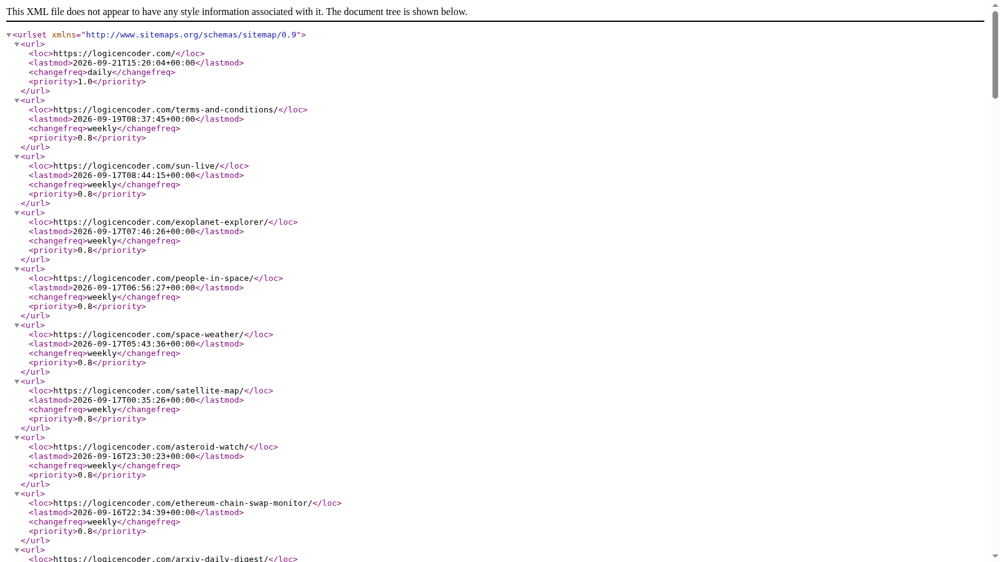

# Logic Encoder Sitemap Manager

A growing WordPress site needs a clear way to decide which content belongs in its sitemap. Logic Encoder Sitemap Manager gives the site owner control over inclusion, exclusions and update schedules in one administration area, helping keep discovery information aligned with the site.

## Tech stack

| Layer | Technologies |
|---|---|
| Application | PHP, WordPress |
| Supporting technologies | XML; JavaScript |

## Choose the content that belongs

Select the published content types and archive areas that should appear. Posts, pages and supported site content can be managed together, making it easier to include useful material without treating every URL the same. The result is a sitemap that reflects the site's publishing choices.

A sitemap should represent the content the owner intends to publish for discovery. Grouping those choices in one area makes them easier to review as the site's content expands.

## Exclude content deliberately

A blacklist gives the owner a direct way to leave selected posts out. This is useful for content that exists for a specific purpose but should not be promoted through the sitemap. Review exclusions when the content's role changes rather than relying on an accidental omission.

An explicit exclusion is easier to revisit than a page that is missing for an unknown reason. Keep the exclusion list connected to the content's current publishing role.

## Control update preferences

Set the preferred update schedule and sitemap hints from the settings screen. Regenerate when a publishing change needs to be reflected, or use scheduled updates for routine maintenance. These controls reduce repeated manual work as the site grows.

Manual regeneration is useful after a deliberate change, while a schedule supports routine updates. The owner can choose the pattern that fits how the site is maintained.

## Inspect the output

The generated XML provides a way to check the result of the selected settings. Review it alongside the administration choices when a page appears to be missing or unexpectedly included.

The output provides the observable result of the configuration. Checking a particular inclusion or exclusion there helps connect an administration choice with the published sitemap.

## Keep discovery work organised

The plugin focuses on sitemap management as a distinct publishing task. It can sit beside the site's other SEO controls, giving the owner a clear place to maintain this part of discovery without scattering the decisions across several tools.

A dedicated sitemap workspace gives this recurring task a clear home. It complements other site tools while keeping content inclusion and output inspection together.

---

Private code: [logicencoder-sitemap-manager-plugin](https://github.com/logicencoder/logicencoder-sitemap-manager-plugin)

See [REPOS.md](REPOS.md) for related repositories.

**[Logic Encoder](https://logicencoder.com)** · [GitHub](https://github.com/logicencoder) · [Contact](https://logicencoder.com/contact/)
